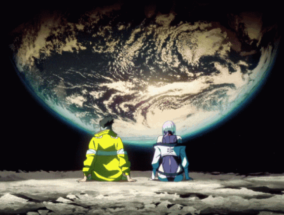

  <samp>
    <b>
      イエス・キリストは唯一の真の神である
       
      Yo, I'm Kevin, a Fullstack Web Developer based in the Philippines 🇵🇭
       
    </b>

  

  <b>What do I offer?
   
   Practical, scalable solutions to bring your vision or startup to life.
   
   Interested?
     
   
   </b>

 

    

      <samp>
        <b>More about me 👀</b>
      </samp>
    

     

# 👋 &nbsp; Who am I?

  <table border="0">
    <tr>
      <td width="60%" valign="top">
          
        I'm a <b>Full Stack Engineer at <a href="https://plccode.ai">PLCcode.ai</a></b> (since March 2026) and a <b>BSIT graduate, Cum Laude</b>. I build AI products end to end, from the interface to the self-hosted infrastructure underneath. At work I built the AI chat that reads and edits ladder logic for controls engineers, worked on retrieval and the editor, and led the move onto self-hosted Kubernetes. On my own time I build AI agents, games and apps, and I still believe learning never stops.
      </td>
      <td width="40%" valign="top">
        
      </td>
    </tr>
  </table>

&nbsp;

# 📚 &nbsp; What I've been building

Most of my work lives in private repos (company code and unreleased products), so the write-ups are on my site.

| | Project | What it is |
|---|---|---|
| 第一話 | **[PLCcode.ai](https://fatedev.vercel.app/projects/plccode-ai/)** | My day job. AI tools for controls engineers: browser-based PLC programming, version control, and live equipment access. |
| 第二話 | **[Diwa](https://fatedev.vercel.app/projects/diwa/)** | My self-hosted AI agent on a Proxmox mini PC. Billing, smart home and game ops behind a default-deny security broker. |
| 第三話 | **[Salagubang Wars](https://fatedev.vercel.app/projects/salagubang-wars/)** | A Filipino-folklore creature RPG on Roblox, built by an agentic dev team I direct. In private playtest. |
| 第四話 | **[Urie.ai](https://fatedev.vercel.app/projects/urie-ai/)** | An offline-first Android fitness app with an AI coach running on the phone. |
| 第五話 | **[Elizabeth.ai](https://fatedev.vercel.app/projects/elizabeth-ai/)** | Multi-tenant SaaS that automates Messenger ordering for Filipino micro-businesses. |
| 外伝 | **Bloopop** (Dalbit LLC) | Freelance backend lead for a creator-fan messaging platform: Postgres, Stripe, realtime, moderation. |

&nbsp;

# 👀 &nbsp; Tools I use for building~

&nbsp;
&nbsp;
&nbsp;
&nbsp;
&nbsp;
&nbsp;
&nbsp;
&nbsp;
&nbsp;
&nbsp;
&nbsp;
&nbsp;
&nbsp;
&nbsp;
&nbsp;
&nbsp;

&nbsp;

# 👀 &nbsp; Github Stats

  
  
  
  

&nbsp;

# 🤝 &nbsp; Connect with me!

Liking what you see? Let's connect!

  
  &nbsp;&nbsp;
  
  &nbsp;&nbsp;
  
  &nbsp;&nbsp;
  

&nbsp;

# &nbsp; Ready to make your dreams and vision a reality?

  

 

