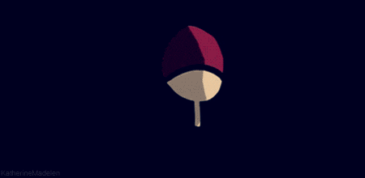

  <samp>
    <b>
      イエス・キリストは唯一の真の神である
       
      Yo, I'm Kevin, a Fullstack Web Developer based in the Philippines 🇵🇭
       
    </b>

  

  <b>What do I offer?</b>
   
  Practical, scalable solutions to bring your vision or startup to life.
   
  Interested?

 

    

      <samp>
        <b>More about me 👀</b>
      </samp>
    

     

# 👋 &nbsp; Who am I?

I'm a **Bachelor of Information Technology** graduate with a constant drive for learning and improvement.  
I’m passionate about creating projects and products that are both **impactful and scalable**.  
I embrace challenges as opportunities for growth and continuously seek to expand my skills through hands-on experience.  
I believe learning never stops and I’ll always be a student, eager to grow, adapt, and evolve.

&nbsp;

## 👀 &nbsp; Tools I use for building~

<!-- Core Languages -->

&nbsp;
&nbsp;
&nbsp;

  

<!-- Frameworks -->

&nbsp;
&nbsp;
&nbsp;

  

<!-- Tools & Platforms -->

&nbsp;
&nbsp;
&nbsp;

  

<!-- Styling & Misc -->

&nbsp;
&nbsp;

&nbsp;

# 👀 &nbsp; Github Stats

  

  

  

&nbsp;

# 🤝 &nbsp; Connect with me!

  
  &nbsp;&nbsp;
  
  &nbsp;&nbsp;
  

&nbsp;

# &nbsp; Ready to make your dreams and vision a reality?

  

 

